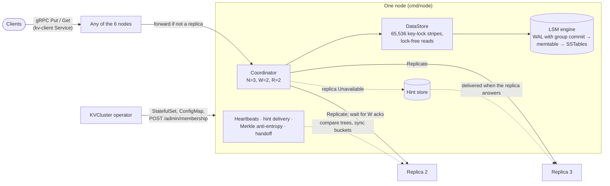
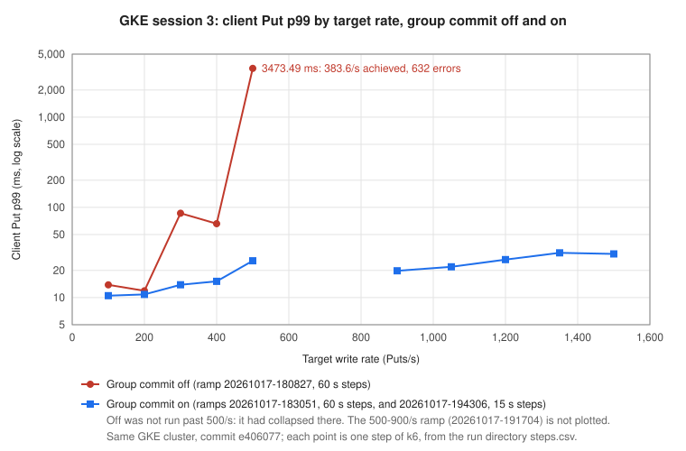
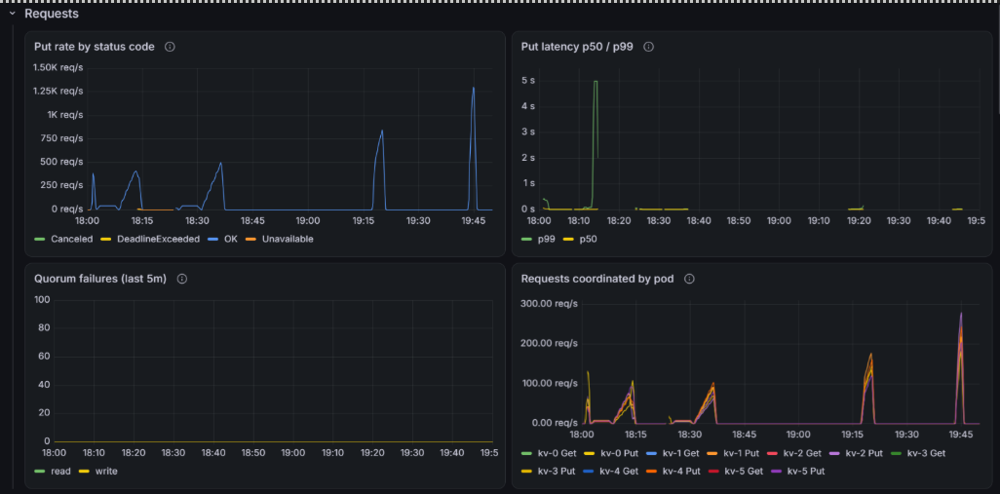
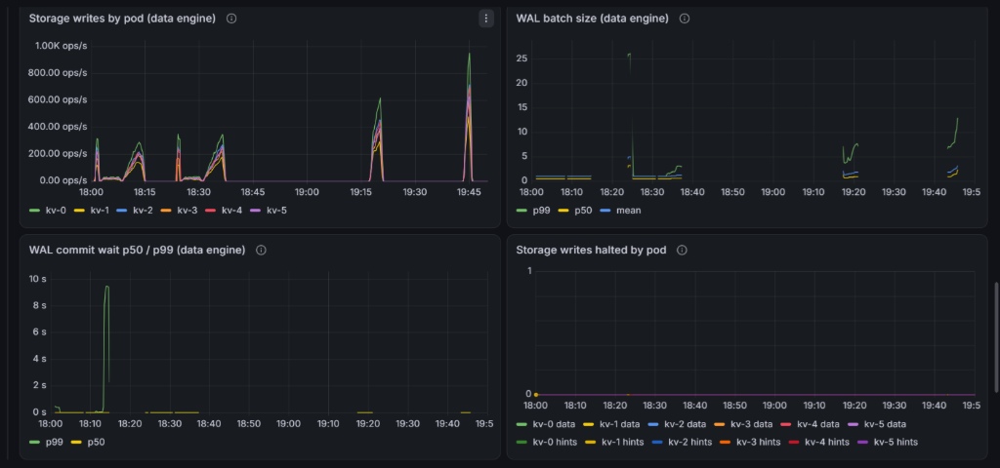

# Distributed KV Store

A leaderless, Dynamo-style key-value store in Go, with a Kubernetes
operator, tested under real failures on GKE.

## Headline results

- **0 of 94,042 acknowledged writes lost, and no stale read**, across four
  faults under load on GKE: a VM, a zone (two of the six nodes), a network
  partition, and the node running the operator and Prometheus. After a full
  anti-entropy interval, every write was on all three of its owners
  ([gke.md](docs/gke.md#convergence-every-acknowledged-write-on-all-its-owners)).
- **Group commit moved the write ceiling from about 400/s to above
  1,500/s**, on the same cluster and commit. At 500/s the client Put p99 was
  3,473 ms with it off (632 errors) and 25.58 ms with it on
  ([gke.md](docs/gke.md#session-3-part-b-results-2026-10-17)).
- **32-33x the write throughput at 64 writers** in the Go benchmarks of one
  node's write path (`DataStore.Put`: 124 to 4,080 writes/s, medians of six
  samples) ([benchmarks.md](docs/benchmarks.md#the-go-write-benchmarks)).
- **Reads: a knee at about 4000/s** on six 2-vCPU GKE nodes, measured in
  session 2 on the previous version (commit `b7a905f`, before group commit
  and the per-key locks) ([benchmarks.md](docs/benchmarks.md#the-read-knee-is-measured-on-gke)).
- **Zone loss failed the keys the ring predicted**: 1,419 of the 5,000 keys
  (28.4%), computed per key before the fault. Every request that failed in
  the fault phase was one the prediction named. The check's one
  disagreement, 451 requests that succeeded early once one of the zone's
  two pods was back, is explained request by request
  ([gke.md](docs/gke.md#test-2-zone-loss-of-c-kv-1-kv-4-no-loss-check-fail-on-451-early-successes)).

## Architecture



Every node runs the same process, and any node accepts a read or a write.
Consistent hashing with virtual nodes puts each key on 3 of the 6 nodes. The
coordinator, one of those 3, versions the write with a vector clock, applies
it locally, and replicates it, answering once 2 replicas have it. A replica
it cannot reach gets a hint, delivered later. Merkle-tree anti-entropy
repairs whatever the hints missed. Concurrent writes are kept as siblings.
Membership changes only when someone announces a higher epoch. The
operator does that for scaling, one node at a time, and never because a node
failed.

## Key decisions

| Decision | Why | Alternative rejected | Evidence |
|---|---|---|---|
| **Group commit with natural batching.** One committer per engine writes whatever queued during the last fsync, with one fsync, and acknowledges only after it | With group commit off, each write held the engine's write lock across its own fsync, so writes queued behind one another while the CPU sat idle | A batching timer, which makes a lone write wait; acknowledging before the fsync (relaxed durability) | [write.go](internal/storage/engine/write.go), [part B](docs/gke.md#session-3-part-b-results-2026-10-17) |
| **Per-key lock stripes, 65,536 of them** (512 KiB per store), with lock-free reads | One store-wide lock made a Get wait a median 57.5 ms behind 8 writers; with stripes, the wait was 0.6 µs. With 1,024 stripes, 6% of writes collided at 64 in flight and Put p99 rose to 1.85× p50, against 1.07× in the engine alone; with 65,536, p99 matched the engine's | The store-wide lock; 1,024 stripes; an exact per-key lock map (kept as the upgrade path) | [datastore.go](internal/store/datastore.go), [benchmarks.md](docs/benchmarks.md#the-go-write-benchmarks) |
| **Halt writes after a failed WAL write or fsync**, until restart; `/livez` fails, so Kubernetes restarts the pod | After a failed fsync the file's contents are unknown, and a retried fsync can report success for data the kernel dropped. After a failed write, a torn record ends the segment, and replay stops there, losing every write acknowledged after it | Return the error and let the next write try again (the behaviour before group commit) | [known-limitations.md](docs/known-limitations.md#durability), [write.go](internal/storage/engine/write.go) |
| **Strict quorums: a hint never counts toward W** | An acknowledged write is on W of its own replicas. A key fails exactly when 2 of its 3 replicas are unreachable, which makes every failure predictable per key | Sloppy quorums, where a stand-in node's hinted copy counts | [chaos.md](docs/chaos.md#the-tools), [coordinate.go](internal/node/coordinate.go) |
| **Membership does not change on transient failures.** Heartbeats mark a peer dead for routing and hints only; the ring changes only on an explicit, higher epoch | A VM that returns within minutes keeps its disk; removing it would move its keys away and back. The epoch stayed 0 through all four GKE faults | Removing unresponsive nodes automatically | [gke.md](docs/gke.md#session-3-results-2026-10-17), [membership.md](docs/membership.md) |
| **Failure tests as written predictions**, computed from the real ring before each fault and checked request by request | The ring is not zone-aware: one zone's loss fails between 6.7% and 45.2% of keys, depending on which two nodes share it. An error rate alone can't show whether the right keys failed | Judging a fault by its overall error rate, or by the ~20% of keys an even ring would lose | [chaos.md](docs/chaos.md), [predictions.txt](docs/results/chaos/20261017-gke/predictions.txt) |

## Two stories

**Finding the write bottleneck.** In GKE session 2, Put p99 rose from 10 to
100-280 ms through the write ramp while the kv pods used 0.21-0.37 cores
and fsync p99 stayed at 4.7-6.1 ms. Neither CPU nor disk was the limit, so
the cause was likely writes queueing for the engine's write lock, held
across each fsync, a wait that no metric timed. A commit-wait histogram
(`kv_wal_commit_wait_seconds`) confirmed it: in GKE session 3 with group
commit off, commit wait p99 reached 9.2-9.6 s at 500/s, while fsync p99
was 9.8 ms. The store had a second, store-wide lock, and it blocked reads
too: per-key lock stripes made reads lock-free, and group commit removed
the write queue
([benchmarks.md](docs/benchmarks.md#gke-2026-10-13-session-2-the-benchmarks),
[open questions](docs/benchmarks.md#open-questions)).

**Predicting a zone loss.** With three zones and N=3, the textbook answer is
that losing a zone fails about 20% of keys. This ring places virtual nodes
unevenly and ignores zones, so `kvchaos predict` computes the answer from
the cluster's real membership and placement instead. For zone c (kv-1 and
kv-4), it predicted 1,419 of the 5,000 keys (28.4%), for Puts and Gets
alike. Under load, outside the windows in which nodes were still noticing
the change, every failed request was for a predicted key; the 451 early
successes were requests to keys whose kv-4 replica had already returned
([chaos.md](docs/chaos.md#the-tools),
[t2-unexpected-success.txt](docs/results/chaos/20261017-gke/t2-unexpected-success.txt)).

## Results

**Group commit off and on**, GKE session 3: the same cluster, commit
`e406077`, write ramps of 60s steps, client side (k6):

| Target/s | Off: achieved/s | Off: p50 / p99 (ms) | Off: errors | On: achieved/s | On: p50 / p99 (ms) | On: errors |
|---|---|---|---|---|---|---|
| 100 | 100.0 | 7.74 / 13.84 | 0 | 100.0 | 7.21 / 10.50 | 0 |
| 200 | 200.0 | 7.07 / 11.88 | 0 | 200.0 | 6.75 / 10.83 | 0 |
| 300 | 300.0 | 7.46 / 86.03 | 0 | 300.0 | 6.76 / 13.87 | 0 |
| 400 | 400.0 | 9.09 / 65.96 | 0 | 400.0 | 6.73 / 15.12 | 0 |
| 500 | **383.6** | 13.38 / **3,473** | **632** | 500.0 | 6.88 / 25.58 | 0 |
| 900 | | | | 899.6 | 8.55 / 19.80 | 0 |
| 1,050 | | | | 1,049.9 | 8.48 / 21.95 | 0 |
| 1,200 | | | | 1,200.1 | 8.50 / 26.36 | 0 |
| 1,350 | | | | 1,350.0 | 8.48 / 31.31 | 0 |
| 1,500 | | | | 1,500.0 | 8.58 / 30.45 | 0 |

The 900 to 1,500/s rows are a later run on a fresh KVCluster, with 15s
steps. Over that run fsync p99 stayed at 4.97 ms, a batch averaged 2.18
writes, and the busiest pod used under 40% of its cores: there was no knee
up to 1,500/s
([gke.md](docs/gke.md#on-900-to-1500s)).



**The failure tests**, GKE session 3, each under a recording load of new
writes and reads of existing keys:

| Fault | Out for | Result against the written prediction |
|---|---|---|
| [VM loss](docs/gke.md#test-1-vm-loss-of-kv-0-t1b-pass) (kv-0, which held the most keys) | 3m37s from the VM's deletion to the pod Ready | As predicted, no key failed: 18,521 Puts and 46,301 Gets, every one ok. The predicted `Degraded` did not appear (open, below) |
| [Zone loss](docs/gke.md#test-2-zone-loss-of-c-kv-1-kv-4-no-loss-check-fail-on-451-early-successes) (zone c: kv-1, kv-4) | 3m55s from the inject to the heal | 1,419 of 5,000 keys predicted to fail; no write lost. The check failed on 451 early successes, a fault in the tool's timeline, now fixed |
| [Partition](docs/gke.md#test-3-partition-of-zone-d-kv-2-kv-3-as-predicted) (zone d cut off, egress only) | 2m2s; every pair of nodes alive again within 2.0s of the heal | As predicted: every key worked on exactly one side, and no request went against its prediction |
| [System-node loss](docs/gke.md#test-4-system-node-loss-zero-errors) (operator, Prometheus, kube-dns) | 3m24s; the operator back after 185.2s | Zero errors, as predicted |

The Grafana panels below cover the whole of part B. The off ramp is at
about 18:08-18:14 UTC, the on ramp at about 18:31-18:36, and the on ramp
from 900 to 1,500/s at about 19:43-19:45. The spike at about 19:17-19:20 is
a fourth ramp, group commit on, 500 to 900/s.



*Requests: off's Put p99 climbs to the histogram's top bucket, 5 s, at
about 18:13 (its 500/s step); the on ramps stay flat.*



*Storage: off's commit wait p99 reaches 9.2-9.6 s at about 18:13, with
batches of 1 write; the on ramps' batches grow with the rate, and their commit wait
stays near zero on this scale.*

## Try it

Needs the Go version in `go.mod` and
[grpcurl](https://github.com/fullstorydev/grpcurl). **A local 3-node
cluster**, each node in its own terminal, from the repository root:

```sh
go build -o kvnode ./cmd/node        # kvnode.exe on Windows
./kvnode -config examples/local/node-1.yaml
./kvnode -config examples/local/node-2.yaml
./kvnode -config examples/local/node-3.yaml

grpcurl -plaintext -d '{"key": "greeting", "value": "hello"}' localhost:7000 kvstore.KVClient/Put
grpcurl -plaintext -d '{"key": "greeting"}' localhost:7001 kvstore.KVClient/Get
```

For up to about a second after the last node starts, a write can fail as
`Unavailable`; retry it ([running-locally.md](docs/running-locally.md)).

**On kind, with the operator** (Docker, kind and kubectl; in Git Bash. For
PowerShell and the cgroup v2 prerequisite, see
[development.md](docs/development.md#make-targets) and
[kubernetes.md](docs/kubernetes.md)):

```sh
kind create cluster --name kvstore --wait 120s --image kindest/node:v1.35.8@sha256:07b2536e30b803ed61d1677a79df6115f798ce64c80f9e22f6ed45afd09323c0
docker build -t kvnode:dev .
docker build -t kvstore-operator:dev operator
kind load docker-image kvnode:dev kvstore-operator:dev --name kvstore
kubectl kustomize operator/config/default | sed 's|image: controller:latest|image: kvstore-operator:dev|' | kubectl apply --server-side -f -
kubectl -n kvstore-operator-system rollout status deploy/kvstore-operator-controller-manager --timeout=180s
kubectl create namespace kvstore
kubectl -n kvstore apply -f operator/config/samples/kvstore_v1alpha1_kvcluster.yaml
kubectl -n kvstore get kvc kv -w       # 6 replicas, PHASE Ready

kubectl -n kvstore port-forward svc/kv-client 7000:7000   # then, in another terminal, the grpcurl lines above, both on :7000
```

**The tests:**

```sh
go vet ./...
go test -race -count=1 ./...
go test -count=1 ./internal/telemetry/ ./internal/storage/wal/ ./internal/storage/engine/   # allocation tests, skipped under -race

# The operator's tests need Linux (envtest): run them in the container.
# As written for PowerShell or Linux; in Git Bash, prefix MSYS_NO_PATHCONV=1
docker run --rm -v "${PWD}:/src" -v kv-gomod:/go/pkg/mod -w /src/operator golang:1.26 make test
```

The `e2e` package builds `cmd/node` and runs real processes: it kills a
whole cluster and checks that every acknowledged write survives
([testing.md](docs/testing.md)). The GKE sessions are in
[gke.md](docs/gke.md) (Terraform in `infra/gke`; session 3 took about 4 hours and $3.40).

## Repository map

| Path | What |
|---|---|
| `cmd/node`, `internal/app` | The node binary, and the wiring of its servers and loops |
| `internal/node` | Coordination, quorums, forwarding, hints, anti-entropy, heartbeats, membership, handoff |
| `internal/store`, `internal/storage/*` | The versioned store with its key locks, and the LSM engine: WAL, memtable, SSTables, compaction |
| `internal/hashring`, `internal/vectorclock`, `internal/versioning`, `internal/merkle` | Placement, versions, siblings, and tree comparison |
| `cmd/kvchaos`, `internal/chaos`, `deploy/chaos` | The failure tests: topology, predictions, the recorder, the check |
| `operator/` | The KVCluster operator, a Go module of its own |
| `deploy/bench`, `deploy/k8s`, `deploy/observability`, `infra/gke` | k6 benchmarks, manifests, Prometheus and Grafana, Terraform |
| `e2e` | End-to-end tests with real processes |
| `docs/results` | Every run's raw output: k6 summaries, Prometheus exports, chaos records |

## Limitations and what was not measured

- **Not measured:** storage overhead (bytes on disk per byte written);
  scaling across cluster sizes (GKE ran 6 nodes only); reads on the current
  code (the read knee is session 2's, before group commit and the key
  locks); and recovery time beyond one sample per fault type.
- **Open findings:** the operator never reported `Degraded`, although kv-0
  was out for 3m37s and the zone's pods for longer. It measures its 2-minute
  `Grace` from the pod object, and a pod recreated mid-outage restarts that
  clock; whether it should follow the member instead is undecided
  ([gke.md](docs/gke.md#test-1-vm-loss-of-kv-0-t1b-pass)). Also open: why
  group commit off collapsed at 500/s in session 3 but held in session 2.
- This is a learning and portfolio project: no authentication or
  encryption, no client-facing delete, an uneven ring, and the gaps listed in
  [known-limitations.md](docs/known-limitations.md).

## Documentation

| Document | Covers |
|---|---|
| [gke.md](docs/gke.md) | The GKE cluster, the session runbooks, and each session's record |
| [chaos.md](docs/chaos.md) | The failure tests: tools, predictions, phases, the kind rehearsal |
| [benchmarks.md](docs/benchmarks.md) | k6 and Go benchmarks, validity checks, every run |
| [operator.md](docs/operator.md) | The KVCluster operator: use, phases, membership changes, recovery |
| [known-limitations.md](docs/known-limitations.md) | What the store does not do, or does imperfectly |
| [docs/README.md](docs/README.md) | Every document, including running locally, kind, membership, observability and testing |

## License

[Apache License 2.0](LICENSE).
